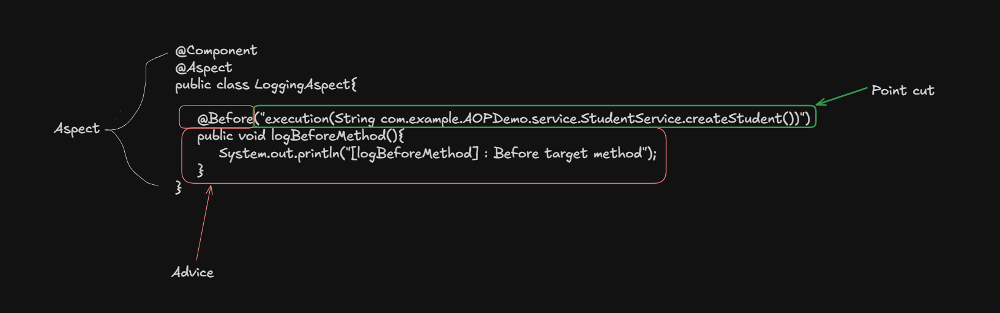
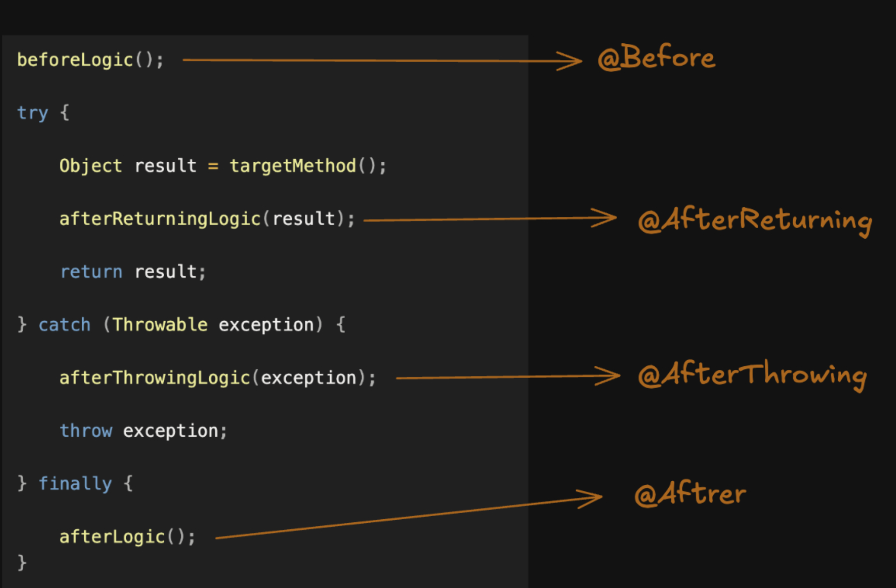

# AOP (Aspect orianted programming)

AOP is programming techinique used to separate common logic (Cross-cutting concerns) from your main business logic

Ex: 
- Suppose you have 20 methods in service and you want to add log before or after execution of those services.
- Without AOP you need to write the same logging code in all methods, which is redundant and not ideal
- With AOP you can write that logging code once outside of service method and use it every where you want

Note: This sounds like writing a separate class and call methods of those classes. but acutally we dont need to call any method, Spring AOP handlers every thing internaly 


### Cross-cutting concerns :

Cross-cutting concerns are functionalities that are needed accros multiple parts of application but are not main business logic of these parts

### Note : Spring AOP use Proxy design pattern at conceptual level 


## AOP terminologies

1. Aspect : class that group cross-cutting logic and rules for applying it in application 

2. Advice : actual action that runs at perticular point during method execution

3. Point cut : define which method execution should receive that advice

4. Target : actual object whose method Spring AOP intercepts

5. Proxy : object that stands between the caller and target object





## Advice Types

### 1. @Before

- Intercepts before the target method start execution

### 2. @AfterReturning

- Intercepts only after the target method returned successfully (without any exception)

### 3. @AfterThrowing

- Intercepts only after the target method returnedn by throwing an exception  


### 4. @After

- Intercepts after the target method returned normally or by throwing exception 


### 5. @Aroung

- Its wrap the target method execution and gives the full control over it 
- So we can intercepts before and after execution 
- It has more power than other type as it can change or modifies arguments, return type, and also consume exception

- Around is same as normal java method that calls our target method, just before and after perform some cross-cutting concerns





## Point cuts

Point cut is a rule that tells Spring AOP which method execution should be intercepted so that the associated advice can run.

We use different deginator to define point cuts

- execution   -> method level
- within      -> class level
- bean        -> bean name
- @Annotation -> method level

These are mostly used deginator

Other designators : 

- @within
- @target
- target
- args
- @args
- this

<hr>

There are some wild cards we use to make pointcute expression flexible

- `*` -> Any single item, such as method name or return type
- `..` -> zero or more items

<hr>

### 1. execution

`execution()` designator is used to match method executions based on the method's return type, class, method name, and parameters.

```java
execution(accessModifier returnType package.ClassName.methodName(parameters) exception)
```

here accessModifier and exception are optional 

Ex : 
```java
    @Before("execution(* com.example.AOPDemo.service.StudentService.*(..))")
    public void logBefore() {
        System.out.println("StudentService method is about to execute");
    }
```

This will match every method in StudentService class

### 2. within 

`within()` designator is used to match method executions based on the class or package where the methods are declared.

It is useful when you want to apply advice to methods belonging to a particular class or package

```java
within(packageName.ClassName)
```

Ex :

```java
@Before("within(com.example.AOPDemo.service.StudentService)")
public void logBefore() {
    System.out.println("Method is about to execute");
}
```

All methods in StudentService class

### 3. bean

`bean()` designator is used to match method executions based on the name of a Spring bean.

```java
bean(beanName)
```

Ex :

```java
@Before("bean(studentService)")
public void logBefore() {
    System.out.println("StudentService method is about to execute");
}
```
All methods in StudentService class


### 4. @annotation

`@annotation()` pointcut designator is used to match method executions based on whether the method has a specific annotation.

Instead of matching methods by their name or package, you can match them by the annotation applied to them.

```java
@annotation(annotationPath)
```

Ex : 

```java
@Before("@annotation(com.example.AOPDemo.annotation.LogExecution)")
    public void logBefore() {
        System.out.println("Method is about to execute");
    }
```

In this we can create out own annotations and use them to perform cross-cutting concerns.


## We can combine two pointcuts and designators

Ex 1:

```java
@Before("bean(StudentService) || bean(StudentController)")
    public void logBefore() {
        System.out.println("Method is about to execute");
    }
```

All methods in StudentService and StudentController


Ex 2:

```java
@Before("within(com.example.AOPDemo.service..*) && execution(public * * (..))")
    public void logBefore() {
        System.out.println("Method is about to execute");
    }
```

All public methods in service package    


## Named pointcut

Named Pointcut is a pointcut that you define once with a name and then reuse in multiple advice methods.

Ex :

```java
@Aspect
@Component
public class LoggingAspect {

    @Pointcut("execution(* com.example.AOPDemo.service.StudentService.*(..))")
    public void studentServiceMethods() {
        //body is always empty
    }

    @Before("studentServiceMethods()")
    public void logBefore() {
        System.out.println("Before method execution");
    }

    @After("studentServiceMethods()")
    public void logAfter() {
        System.out.println("After method execution");
    }
}
```

In industry we mostly use named point cuts

We create named point cuts in saperate file and use them every where