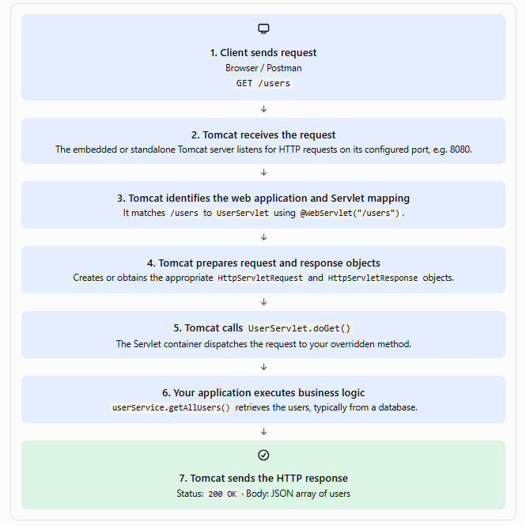

# CRUD Servlet Demo

## How to run this web application 

To run this, we need External Tomcat server in our system. 

- First create package of this project using mvn clean package (.war file)
- Copy this .war file in the webapps folder of the Tomcat server
- Run the Tomcat server
- Open the browser and enter the URL : http://localhost:8080/CURDServletDemo/

### Note :
   1. Tomcat server Can Run Multiple Web Applications
      - External Tomcat can host multiple Java web applications at the same time
      - Ex: 
         ```
         External Tomcat
         ├── app1
         │  └── HelloServlet
         │
         ├── app2
         │  └── LoginServlet
         │
         └── app3
            └── ProductServlet
         ```

   So that why our url become` http://localhost:8080/crud-app/`

   We have defined this in pom.xml file, for app name
   ```
      <build>
         <finalName>crud-app</finalName>
      </build>
   ```


## How request is handled here

what happens inside Tomcat when a user sends GET /users to your Servlet application




### Note : In external Tomcat, Servlets are loaded `lazily` by default