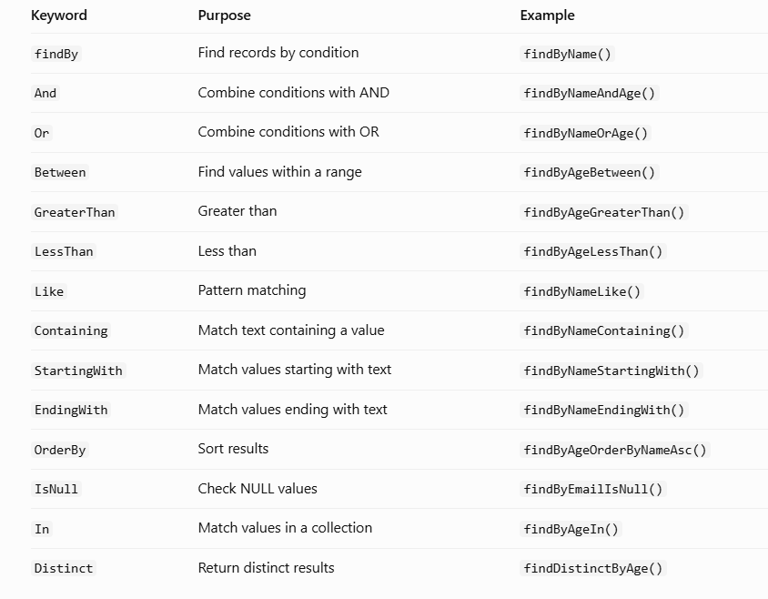
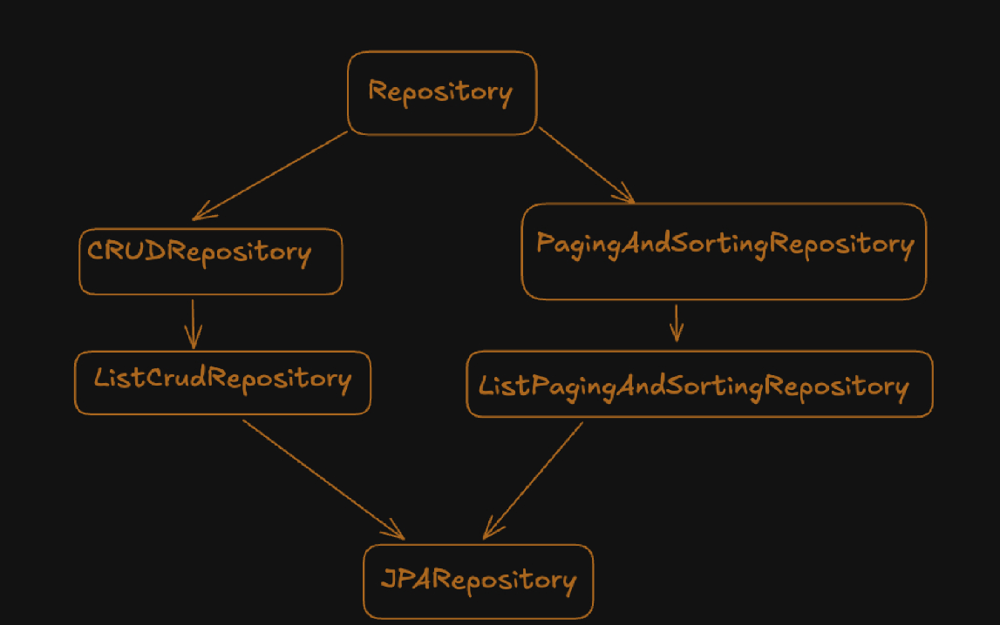
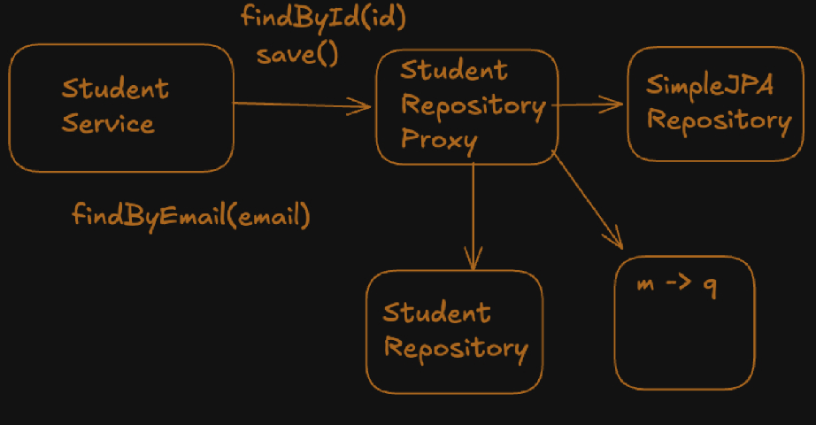

# Spring Data

Spring Data is a family of Spring projects that makes it easier to work with different data stores, such as relational databases, MongoDB, Redis, and Elasticsearch.

It provides common abstractions so developers can perform data-access operations with less boilerplate code.


## Spring Data JPA

Spring Data JPA is the Spring Data module used with JPA and relational databases.

It builds on JPA and lets you create repository interfaces instead of writing common CRUD code manually.


### Without Spring Data JPA

You might use `EntityManager` directly:

```java
@Repository
public class StudentRepository {

    @PersistenceContext
    private EntityManager entityManager;

    public Student findById(Long id) {
        return entityManager.find(Student.class, id);
    }

    public void save(Student student) {
        entityManager.persist(student);
    }
}
```

### With Spring Data JPA

```java
public interface StudentRepository
        extends JpaRepository<Student, Long> {
}
```


## How it fits with JPA and Hibernate


```
Your Service
    ↓
Spring Data JPA Repository
    ↓
JPA (EntityManager)
    ↓
Hibernate (JPA implementation)
    ↓
JDBC
    ↓
Database
```


## Main responsibilities of Spring Data JPA


### 1. It ptovides common CRUD opertions
- save()
- fingById()
- findAll()
- count()
- deleteById()
- existsById()


### 2. Query derivation from method names

Spring Data JPA that allows you to write database queries by defining method names in your repository interface.

Spring Data JPA reads the method name, understands what query you want, and automatically generates the implementation.

Ex : 

```java
public interface StudentRepository
        extends JpaRepository<Student, Long> {

    Student findByName(String name);
}
```
Spring Data JPA derives a query equivalent to:

```sql
SELECT *
FROM student
WHERE name = 'abc';
```

### Common query derivation keywords




### 3. JPQL and Native SQL

In Spring Data JPA, you can write custom queries using JPQL and Native SQL with the @Query annotation.


- <b>JPQL (Java Persistence Query Language) </b>

    JPQL is a query language provided by JPA. It allows you to write queries using entity class names and Java entity properties instead of database table and column names.

    ```java
    @Query("SELECT s FROM Student s WHERE s.name = :name")
    List<Student> findStudentsByName(@Param("name") String name);
    ```

    Here <br>
    - `Student` is the entity class name, not the database table name.<br>
    - `name` is the Java entity property.

- <b>Native SQLNative SQL</b>

    Native SQL allows you to write queries directly in the database's SQL language.<br>
    We work with actual database table and column names.

    ```java
    @Query(
    value = "SELECT * FROM students WHERE name = :name",
    nativeQuery = true
    )
    List<Student> findStudentsByName(@Param("name") String name);
    ```

    Here:
    - `students` is the actual database table.
    - `name` is the actual database column.
    - `nativeQuery = true` tells Spring Data JPA to execute this as native SQL.

### 4. Sorting and Pagination

Spring Data JPA provides built-in support for sorting and pagination, so you don't need to write SQL queries manually for common use cases.


## Repository Interface Hierarchy




### 1.  Repository

Repository is primarily a marker interface 

Extending it does not automatically expose the full CRUD API. This allows a
restricted repository contract

```java
public interface StudentRepository extends Repository<Student, Long> {
    
    Student save(Student student);

    Optional<Student> findById(Long id);

    List<Student> findAll();
}
```
Because no delete method is declared, callers cannot delete students through this
repository interface.

### 2. CrudRepository

CrudRepository extends Repository and provides generic CRUD operations:

```java
public interface CrudRepository<T, ID> extends Repository<T, ID> {
    <S extends T> S save(S entity);

    Optional<T> findById(ID id);

    Iterable<T> findAll();
    
    boolean existsById(ID id);

    long count();

    void deleteById(ID id);

    void delete(T entity);
}
```

### 3. ListCrudRepository

`ListCrudRepository` offers CRUD functionality similar to `CrudRepository` , but methods returning multiple entities return a `List` instead of an `Iterable`


### 4. PagingAndSortingRepository

This interface adds sorted and paginated retrieval:

```java
Iterable<T> findAll(Sort sort);

Page<T> findAll(Pageable pageable)
```


### 5. JpaRepository

It provides three broad groups of operations.

- CRUD operations
- Sorting and pagination
- JPA-specific operations

    ```
    flush()
    saveAndFlush()
    saveAllAndFlush()
    getReferenceById()
    deleteAllInBatch()
    deleteAllByIdInBatch()
    ```


## Q. How does Spring Data JPA provide an implementation of our repository interface even though we don't define the implementation ourselves?

```java
public interface StudentRepository extends JpaRepository<Student, Long> {
}
```

```java
public class StudentService {

    private StudentRepository studentRepository;

    public StudentService(StudentRepository studentRepository){
        this.studentRepository = studentRepository;
    }
}
```

When we create this and pass in Student Service, Spring framework pass proxy object because we can create object of StudentRepository as it is interface.

Spring Data creates a runtime object that implements the repository interface. This
runtime-generated object is called a repository proxy.


We think this proxy provides implementaion, but actully it don't. 

`SimpleJpaRepository` this class provides actual implementation

### SimpleJpaRepository: 

Spring Data JPA uses SimpleJpaRepository as the default implementation for common CRUD methods defined by JpaRepository, such as save(), findById(), findAll(), and deleteById().


When customer method is called like `findByEmail()` at that time repository proxy called special class that is responseible for converting method name into SQL query.


So, `repository proxy` have to desice what to called according to request.




## Q. Why We use Spring-Data-JPA

Spring Data JPA simplifies database operations by providing ready-made repository methods and reducing boilerplate code. It uses JPA for persistence and typically Hibernate as the ORM implementation.
