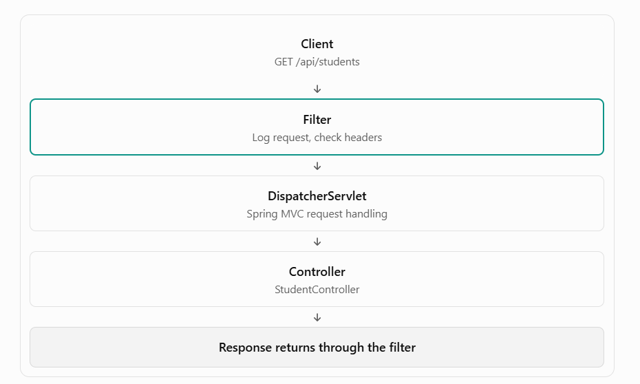

# Filters in Spring

Filters are used to intercept HTTP requests and responses before they reach the controller or before the response goes back to the client.

Filters belong to the Servlet API, which means they work at the web-server level, typically before Spring MVC processes the request.

For example, a filter can:
- Log incoming requests.
- Check whether a request contains a required header.
- Add security-related headers to responses.
- Measure request processing time.
- Reject requests that do not meet certain conditions.




# How to create filter

We need to implement `Filter` interface provided by `import jakarta.servlet.*;`

In this we need to Override `doFilter` method in that we write our code 

THis method takes 3 parameters S`ervletRequest request,      ServletResponse response, FilterChain chain`

Using chain we can call next filter in line 

Ex : `chain.doFilter(request, response);`


### @Order()

`@Order` is an annotation used to define the priority or execution order of components when multiple components of the same kind need to be processed in sequence.

Using this we deside filters order in which they should execute

Ex :
In this order we need to execute the filter generally 

```
Logging

Authentication

Validation

Controller
```

### Note :

- If we try to modify response after caling `chain.doFilter()` we can't change it because once response is commited by controller then it become read only obj so we can change it.

- We can modify response before calling `chain.doFilter()`


- If we want to change or modify response body, we can't do it direclty. But we can use Wrapper for it. 
`ContentCachingResponseWrapper`

    We send this wrapper to next filter and so one 


    ```java
    ContentCachingResponseWrapper wrapperResponse = new ContentCachingResponseWrapper(); 

    chain.doFilter(servletRequest, wrapperResponse);

    byte[] originalbytes = wrapperResponse.getContectAsByteArray();

    String originalBody = new String(originalbytes);
    String modifiedBody= """
                        {
                            "originalResponse" : %s,
                            "appName" :"Demo"
                        }
                         """.formatted(originalBody);

    wrapperResponse.resetBuffer();

    wrapperResponse.getWrite().write(modifiedBody);

    wrapperResponse.copyBodyToResponse();
    ```

    Note : Try to avoid modifying the response


- In Request, Http Method, end point, headers, and Request parameters are read only we can't chnage or modify them 

    We can modify these using wrapper (We should not do this)


## Imp. Reading the Request Body in a Spring Boot Filter

### What is the problem?

In Spring Boot, reading the HTTP request body inside a filter can cause problems because the request body is generally exposed as a one-time readable stream.

If a filter consumes the request body, the controller may not be able to read it again.

This commonly affects `POST`, `PUT`, and `PATCH` requests containing JSON data.

### Example Scenario

Suppose a client sends the following request:

```
POST /api/students
Content-Type: application/json

{
    "name": "Samarth",
    "age": 22
}
```


Filter

```java
String body = request.getReader()
        .lines()
        .collect(Collectors.joining());

System.out.println(body);

chain.doFilter(request, response);
```

Controller

```java 
@PostMapping("/students")
public String createStudent(@RequestBody Student student) {
    return student.getName();
}
```


1. The client sends the JSON request body.

2. The filter reads the body using request.getReader().

3. The request stream is consumed.

4. The filter calls chain.doFilter().

5. Spring MVC attempts to read the body and convert it into a Student object.

6. The body may be empty, causing deserialization errors or an empty request body.


### Why does this happen?

The Servlet API exposes the request body through:

```
request.getInputStream()

request.getReader()
```

Both provide access to the request body as a stream.

Once the stream has been consumed, the same request does not automatically provide the original bytes again.

For Examle check file : SpringFilterDemo\src\main\java\com\example\SpringFilterDemo\filter\RequestFilter.javaava 

### Note : Java `Streams` can only be read or consumed exactly once

### Solution to read body : Use a Request Wrapper

If the body must be available to both the filter and the controller, use a request wrapper that buffers the body and allows downstream code to read it.


## OncePerRequestFilter class

`OncePerRequestFilter` is a Spring class that implements the Filter interface

It provide HttpServletRequest and HttpServletResponse by default.


### shouldNotFilter() :
It is a method provided by OncePerRequestFilter. You override it when you want to skip your filter for specific HTTP requests.

For example, suppose you have a JWT authentication filter. You want to check the JWT for protected APIs, but you don't want to check it for /login or /register.

You can use shouldNotFilter() for that.

```java
@Override
protected boolean shouldNotFilter(HttpServletRequest request)
        throws ServletException {

    return request.getRequestURI().equals("/login");
}
```

- Returns `true` → skip your filter's `doFilterInternal()` logic.
- Returns `false` → execute your filter's `doFilterInternal()`logic.